# Updating To Version 21

Version 21 installs into a new folder, `custom_components/edfenergy_uk`, and is listed as
**EDF Energy (UK)** instead of **EDF Energy**. Everything the integration does is unchanged.

HACS downloads the new folder but leaves the old one in place, and Home Assistant will not
start using the new folder on its own. There is one step to finish by hand, and what you see
on screen depends entirely on which version you are updating **from**.

Nothing is lost at any point. Your account, your API key, every entity id, your history and
your Energy dashboard statistics all come across, so automations, scripts, dashboards and
template sensors carry on untouched.

!!! danger "On Home Assistant 2026.11 or later, read this first"

    From 2026.11, HACS is part of Home Assistant as the **Marketplace**, and the Marketplace
    won't update an integration whose folder has changed name. If you're on 20.x or older,
    the update fails with *"changed its domain from edf_energy to edfenergy_uk"*.

    **Don't delete the integration to get past it.** Follow
    [Updating with the Marketplace](#updating-with-the-marketplace-home-assistant-202611-and-later)
    instead, and everything comes across.

!!! warning "If HACS refuses the update with a missing manifest"

    If the update fails with `No manifest.json file found 'custom_components/edf_energy/manifest.json'`,
    **restart Home Assistant and try again.**

    HACS works out where an integration's folder lives the first time it looks, then reuses
    that answer for the rest of the session - so it goes hunting for the old folder inside the
    new release and gives up. That answer is never written to disk, it is worked out afresh
    every time Home Assistant starts, so a restart is all it takes. The update then goes
    through as normal and installs into the new folder.

    This affects every existing installation, so if you have not updated yet, restart first.

## Updating with the Marketplace (Home Assistant 2026.11 and later)

Home Assistant 2026.11 brought HACS into Home Assistant itself as the **Marketplace**. If
you were on 20.x or older when you updated Home Assistant, this is the section for you. The
paths further down this page are for HACS, and their first step is the one the Marketplace
won't do.

It takes about ten minutes and two restarts. Your account, your API key, every entity id,
your history, your Energy dashboard statistics, your cost trackers and any suggestions
you've dismissed all come across.

### What you'll see

The update is offered as normal in **Settings > System > Updates**, but pressing **Update**
fails:

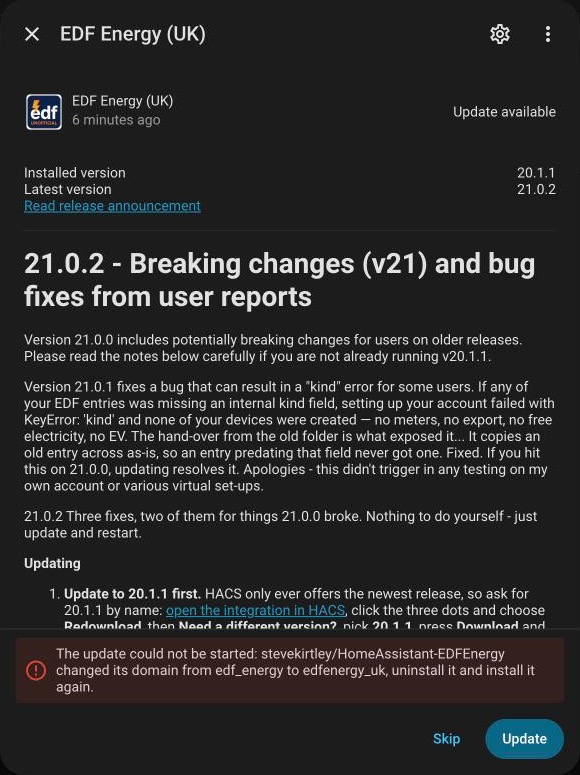

The message suggests uninstalling, but the Marketplace won't uninstall it while it's still set
up. Instead it offers to delete your setup for you:

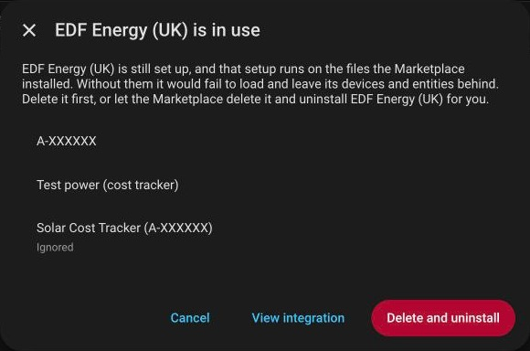

!!! danger "Press Cancel here"

    **Delete and uninstall** deletes your account and every cost tracker from Home Assistant,
    along with their devices, entities and customisations. You'd have to set everything up
    again, including your EDF password. You don't need it: the steps below get you to the
    same place with everything intact.

!!! note "If the Marketplace asks you to read a warning first"

    The first time you open the Marketplace it shows **Before you install from the
    Marketplace**. Tick **I understand the risks and agree** and press **Continue**. Until
    you do, nothing can be updated, installed or uninstalled.

    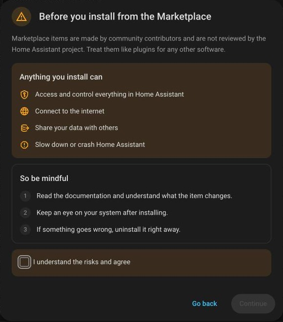

### Step 1: get the new folder

Open the [latest release](https://github.com/stevekirtley/HomeAssistant-EDFEnergy/releases/latest)
on GitHub, scroll to **Assets** at the bottom and download **Source code (zip)**.

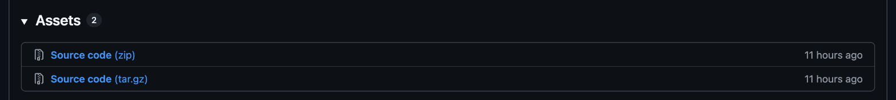

Unzip it. Inside is a `custom_components` folder, and inside that is `edfenergy_uk`.

### Step 2: copy it into Home Assistant

Copy the `edfenergy_uk` folder into the `custom_components` folder of your Home Assistant
configuration, using whichever you already have: the **File editor**, **Samba share**,
**Studio Code Server** or **SSH** add-on. When you're done it should look like this:

```
config/
└── custom_components/
    ├── edf_energy/        <- the old one, leave it where it is
    └── edfenergy_uk/      <- the one you just copied in
```

Don't delete `edf_energy`. It's still running your account, and the Marketplace will remove
it for you in step 5.

### Step 3: restart Home Assistant

**Settings > System**, then the power button in the top right, then **Restart Home
Assistant**. Everything carries on as before: the old folder is still running your account.

### Step 4: take your setup over

Go to **Settings > Devices & services > Add integration** and search for `EDF`. You'll see
both names. Choose **EDF Energy (UK)**:

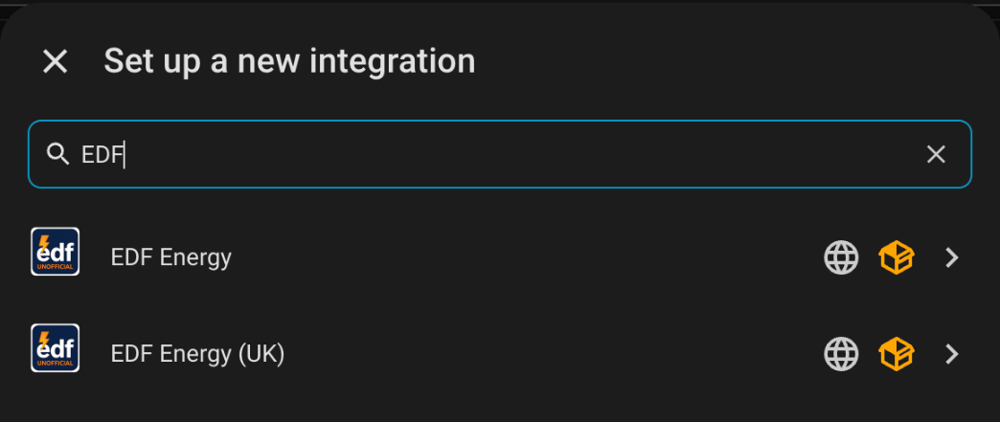

Instead of asking for your login, it offers to take over the setup you already have:

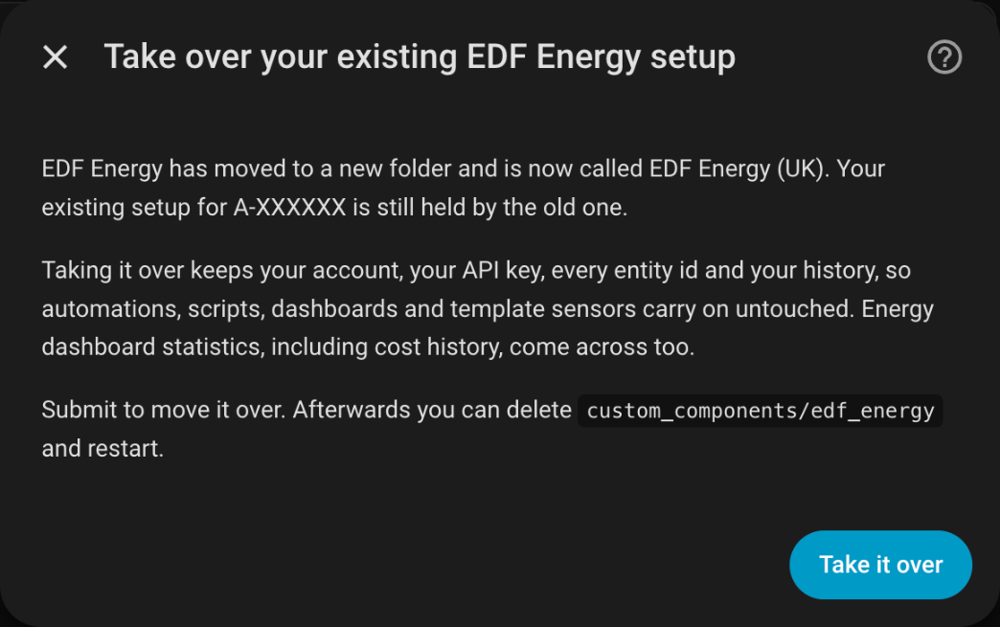

Press **Take it over**. There's nothing to fill in.

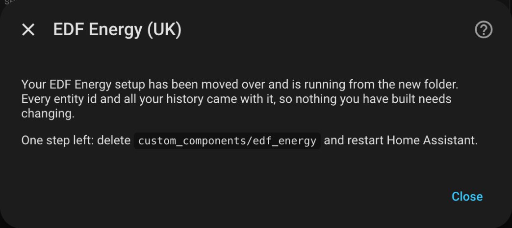

Your account is now running from the new folder. The notice tells you to remove the old
one. With the Marketplace, that's the next step. Don't delete `custom_components/edf_energy`
by hand: that would leave the Marketplace thinking the old one is still installed.

!!! tip "On 20.1.1 there's a shortcut"

    If you were on 20.1.1, a notice appears in **Settings > Repairs** after the restart in
    step 3. Its **Hand it over** button does the same as this step.

    It needs 21.0.4 or later in the folder you copied in step 2. With 21.0.3 it fails with
    *"The hand-over did not finish"*, and nothing is changed. Use **Add integration** as
    above instead.

    

### Step 5: uninstall the old one in the Marketplace

!!! warning "Do steps 5 and 6 together, without restarting in between"

    The Marketplace forgets about an uninstalled custom repository when Home Assistant
    restarts. If you restart between these two steps, it won't be listed any more, and
    you'll have to add it back as a custom repository before you can do step 6.

Open the **Marketplace** and go to **Installed**. Press the three dots next to
**EDF Energy (UK)** and choose **Uninstall**:

!!! info "Why it already says EDF Energy (UK)"

    The Marketplace lists a repository once, under the name its newest release gives it. So
    the old 20.x install shows as **EDF Energy (UK)** here, even though Devices & services
    still calls the old one **EDF Energy**. If the Marketplace hasn't been able to check
    GitHub yet, it may still show **EDF Energy**. Either way it's the one by stevekirtley,
    and it's the only EDF entry under **Installed**.

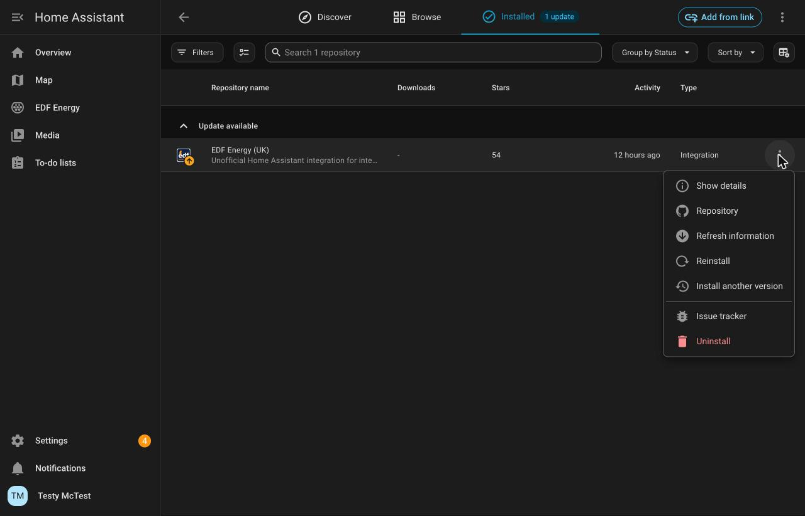

This time it doesn't say it's in use, because nothing is set up on the old folder any more.
It just asks you to confirm:

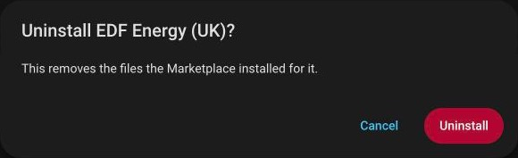

Press **Uninstall**. This deletes `custom_components/edf_energy` and nothing else. Your
setup is running from `edfenergy_uk`, which the Marketplace doesn't know about yet.

### Step 6: download it again

Go to **Browse** and search for `EDF Energy`. **EDF Energy (UK)** is listed under
**Available** or **Restart required**:

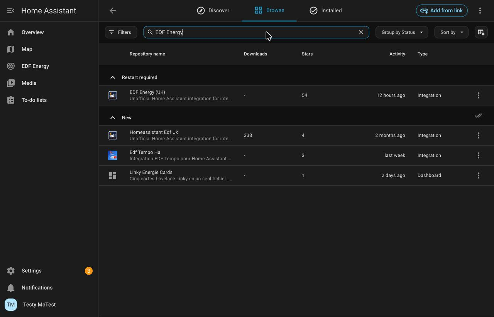

!!! warning "Pick EDF Energy (UK), not Homeassistant Edf Uk"

    **Homeassistant Edf Uk** in the same list is a different integration by another
    developer. It isn't a newer version of this one, and it installs into the old
    `edf_energy` folder.

Press the three dots next to **EDF Energy (UK)** and choose **Refresh information**
first. Then open the three dots again and choose **Install**:

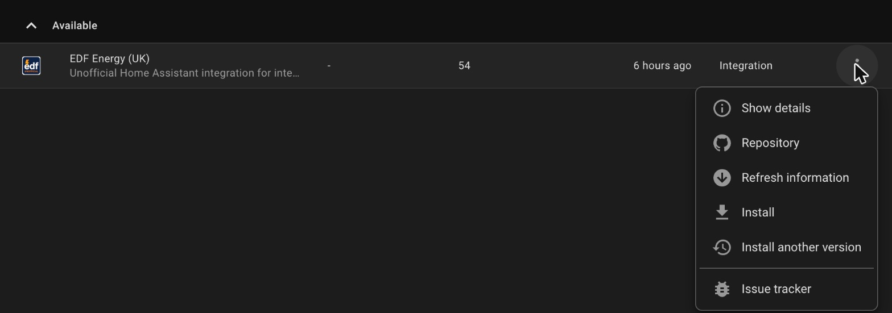

!!! warning "Don't skip Refresh information"

    The Marketplace still has the old folder name on record. It only checks GitHub again by
    itself once per session, and if you tried the update first, that check has already been
    used up. Without a refresh, Install fails with:

    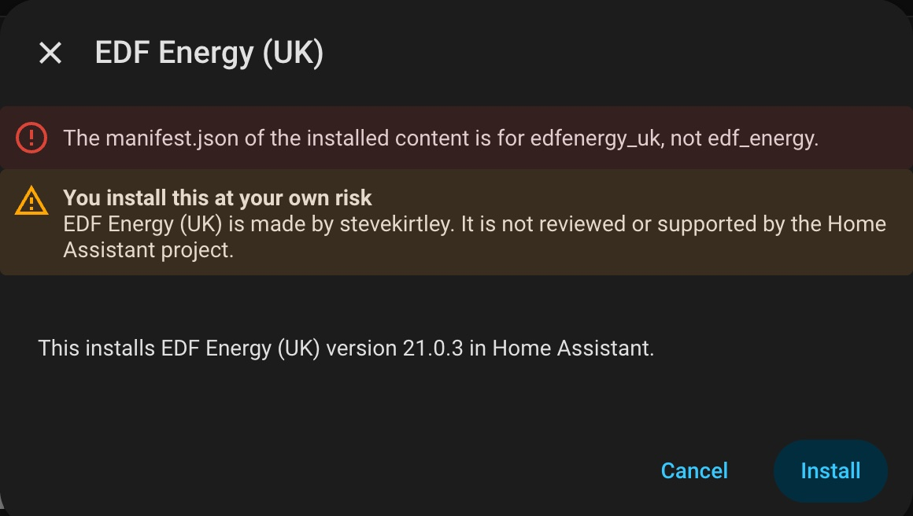

    Nothing is lost if you see this. Press **Cancel**, choose **Refresh information**, then
    **Install** again.

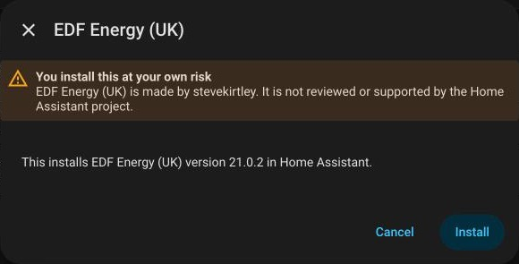

Press **Install**. It installs into `edfenergy_uk`, replacing the copy you made in step 2
with the same version, and from now on the Marketplace is managing it again.

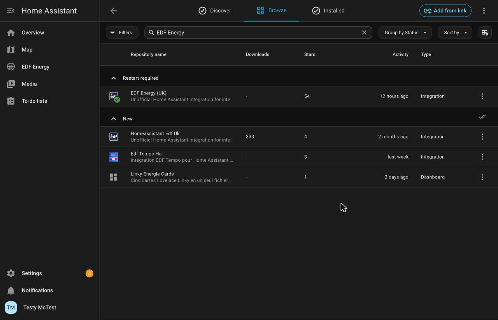

### Step 7: restart Home Assistant

Restart once more. The Marketplace now shows **EDF Energy (UK)** as installed, **Settings >
System > Updates** has nothing waiting, and the notices about the old folder have gone.

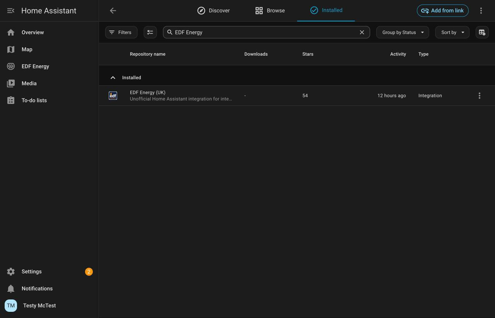

Future updates arrive in **Settings > System > Updates** like any other.

### If you restarted between steps 5 and 6

Nothing has stopped working, because your account is running from the copy you made in
step 2. But the Marketplace no longer lists the integration, so it won't offer you updates.
To get it back, open the **Marketplace**, press the three dots in the top right, choose
**Custom repositories**, add `https://github.com/stevekirtley/HomeAssistant-EDFEnergy` with
type **Integration**, and then do step 6.

Adding a custom repository needs a GitHub account connected to the Marketplace. If you came
from HACS, yours carried over.

---

## First, check which version you are on

In HACS, open **EDF Energy**. The version you have installed is shown at the top of the page.

| You are on | What happens when you update | What you need to do |
|---|---|---|
| **20.1.1** | The integration keeps running and puts a notice in **Repairs** | One click. [Go to Path A](#path-a-updating-from-2011) |
| **20.1.0** | The integration stops loading and every entity goes unavailable | Update to 20.1.1 **first**. [Go to Path B](#path-b-updating-from-2010) |
| **20.0.0 or any 19.x** | Nothing changes and nothing prompts you | Start the move yourself. [Go to Path C](#path-c-updating-from-2000-or-any-19x) |

!!! tip "The short version"

    Whatever you are on, updating to **20.1.1** and restarting before you take version 21 gives
    you the easiest path. From 20.1.1 the integration walks you through the rest.

---

## Path A: updating from 20.1.1

This is the guided path. After HACS downloads version 21 and you restart, the old folder
carries on running your account exactly as before — nothing goes unavailable — and a notice
appears in **Settings > System > Repairs**:


Click it, and you get this:


Press **Hand it over**. That is the whole move — there is nothing to fill in and nothing to
reconfigure. Your account is now running from the new folder.

Then follow [Afterwards](#afterwards-deleting-the-old-folder) to clear out the old folder.

!!! info "If the notice does not appear"

    Restart Home Assistant. A folder HACS has only just downloaded is not picked up until a
    restart, and the notice is raised when the integration next starts.

---

## Path B: updating from 20.1.0

!!! warning "Update to 20.1.1 first"

    Going straight from 20.1.0 to version 21 stops the integration loading. Every entity goes
    unavailable and stays that way until you finish the move by hand.

    In HACS, update to **20.1.1**, restart Home Assistant, and then take version 21. You will
    then be on [Path A](#path-a-updating-from-2011) and get the one-click prompt.

### If you have already updated

Your EDF Energy entry in **Settings > Devices & services** will be showing an error, and the
log will have:

```
Replaced by edfenergy_uk. Delete custom_components/edf_energy and restart.
```

There is also a notice in Repairs titled **EDF Energy has moved to a new folder**.

!!! danger "Do not follow that advice"

    Both that message and that notice tell you to delete `custom_components/edf_energy` and
    restart. **That does not fix it**, and if you do it first you are left with your account
    attached to a folder that is no longer there, with nothing on screen explaining why.

    This was wrong in 20.1.0 and is corrected from 20.1.1 onwards. Use the steps below instead.

To recover, hand the account over from the new integration's own setup screen. These are the
same steps as [Path C](#path-c-updating-from-2000-or-any-19x) below.

1. Go to **Settings > Devices & services** and press **Add integration**.
2. Search for `EDF`. While both folders are installed you will see an entry for each, and the
   name is what tells them apart — the new one has **(UK)** on the end.

    

3. Choose **EDF Energy (UK)**. It finds the setup the old folder is holding and offers to take
   it over:

    

4. Press **Take it over**. You get a confirmation that the move is done, and your entities come
   back:

    

This works whether or not you have already deleted the old folder, so if you followed the wrong
advice before reading this, the same steps still put you right.

Then follow [Afterwards](#afterwards-deleting-the-old-folder).

---

## Path C: updating from 20.0.0 or any 19.x

!!! warning "Nothing will prompt you"

    These versions know nothing about the new folder. After you update, **the old folder simply
    carries on working** — every entity stays available and nothing appears in Repairs — while
    the new folder sits on disk doing nothing.

    It looks like the update worked. It downloaded, but none of version 21 is running, and it
    will stay that way until you do the step below. HACS will show version 21 as installed, so
    nothing further will remind you.

The tidiest route is to update to **20.1.1** first and restart, which puts you on
[Path A](#path-a-updating-from-2011) and does the rest for you.

If you are already on version 21, start the move yourself using the **Add integration** steps
shown in [Path B](#if-you-have-already-updated) above — search for `EDF`, choose
**EDF Energy (UK)**, and press **Take it over**.

Then follow [Afterwards](#afterwards-deleting-the-old-folder).

---

## Afterwards: deleting the old folder

Once your account has moved, the notice from the old folder goes and a new one takes its place:


Press **Delete it**, then restart Home Assistant. Until you restart, Home Assistant carries on
listing the copy it had already loaded — that is expected and harmless.

If you would rather do it yourself, delete the `custom_components/edf_energy` folder and restart.
Leaving it in place does not break anything, but Home Assistant will keep listing it and the
notice will keep coming back.

## What carries over

| | Comes across |
|---|---|
| Account number and API key | Yes |
| Every entity id | Yes, unchanged |
| Entity history | Yes |
| Energy dashboard statistics, including cost history | Yes |
| Automations, scripts, dashboards, template sensors | Keep working untouched |
| Cost tracker and tariff comparison sensors | Yes |

You do not need to re-enter your credentials, and you do not need to edit anything that refers
to an EDF Energy entity.

## Questions

### Will my automations break?

No. Entity ids are preserved exactly, so anything that refers to them carries on working.

### Do I need my password again?

No. Your stored API key moves across with the account.

### Why has it moved at all?

The folder name and the listed name both needed to change for the integration to be distinct
within HACS. The rename is the whole of it — no features have been removed.

### Can I just delete the old folder and let the new one pick things up?

No. Home Assistant only starts an integration that something already refers to, and until the
hand-over has happened nothing refers to the new folder. Deleting the old folder first leaves
your account attached to nothing. Always hand it over first, then delete.

### I pressed the old EDF Energy in the Add integration list by mistake

From 20.1.1 that is harmless — the old one stops short and points you at **EDF Energy (UK)**.
Nothing can end up set up twice.

### Where do I get help?

See the [new folder repair notes](../repairs/new_folder.md), the [FAQ](../faq.md), or raise a
[discussion](https://github.com/stevekirtley/HomeAssistant-EDFEnergy/discussions).
