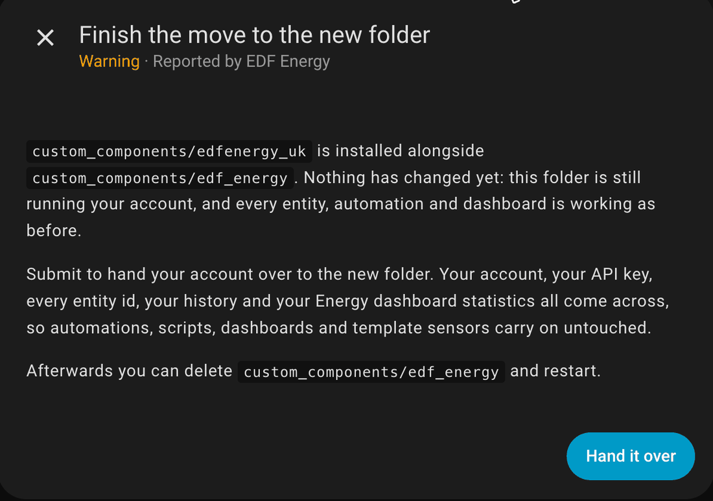

# Repairs - EDF Energy has a new folder

From version 21 this integration installs into `custom_components/edfenergy_uk` instead of
`custom_components/edf_energy`. HACS adds the new folder but leaves the old one in place, so
for a while both are on your system and there is one step to finish by hand.

Nothing is broken in the meantime. Until you complete the step below, the old folder carries
on running your account exactly as before.

## Finishing the move

If you updated from 20.1.1 you will have a notice in **Settings > System > Repairs** titled
**EDF Energy has a new folder - one step left**. Open it and press **Hand it over**. That is
the whole move - there is nothing to fill in and nothing to reconfigure.

If you have no such notice, or you updated from an older version, start it yourself instead:

1. Go to **Settings > Devices & services** and press **Add integration**.
2. Choose **EDF Energy (UK)**. Both are listed while the old folder is still there, and
   this is the new one.
3. It will tell you it has found your existing setup and ask to take it over. Confirm.

Your account, your API key, every entity id and your history all carry across, so
automations, scripts, dashboards and template sensors keep working untouched. Energy
dashboard statistics, including cost history, come with it.

For the full picture, including what to expect from each version you might be updating from,
see [Updating to version 21](../migrations/version_21.md).

## Afterwards

A second notice appears saying the old folder can go. It has a **Delete it** button that
removes `custom_components/edf_energy` for you. Restart Home Assistant afterwards - until
you do, Home Assistant carries on listing the copy it had already loaded.

If you leave it there nothing stops working, but the folder is doing nothing and Home
Assistant will keep listing it.

The notice only appears when the folder is the one this integration came from. A separate EDF
integration, [HomeAssistant-EDF-UK](https://github.com/Bobby5291/HomeAssistant-EDF-UK), also
installs into `custom_components/edf_energy`. If that's what is in the folder, there's no notice
and nothing is deleted, and its config entries aren't offered for take-over either.

## If "EDF Energy (UK)" is not in the Add integration list

Restart Home Assistant and try again. The new folder is only picked up on a restart after
HACS has downloaded it.

## If you pick the wrong one

Nothing happens. The old **EDF Energy** stops short and tells you to use **EDF Energy (UK)**,
so there is no way to end up with your account set up twice.
